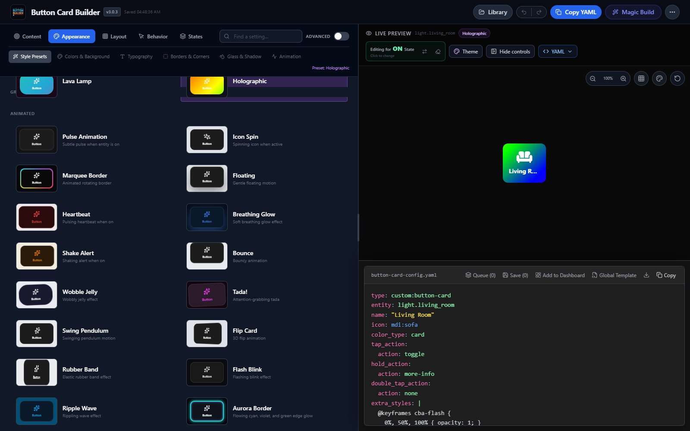
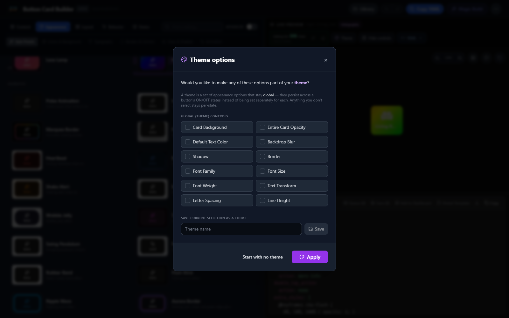

<div align="center">


# Button Builder for Home Assistant

**Design custom Home Assistant buttons visually — without hand-writing YAML.**

Customize layouts, colors, icons, actions, animations, and on/off states in a live editor. Import an existing `custom:button-card` configuration or start with a preset, then export the YAML for your dashboard.

[](https://github.com/aspenrt78/button-builder/releases)
[](LICENSE)
[](docs/INSTALLATION.md)
[](https://www.buymeacoffee.com/aspenrt78)

[**Install Button Builder**](docs/INSTALLATION.md) · [**Build your first button**](docs/QUICKSTART.md) · [**Report an issue**](https://github.com/aspenrt78/button-builder/issues)

</div>


## What you can do

- **Design visually:** Change layout, typography, icons, color, gradients, borders, shadows, and visual effects with a live preview.
- **Style by state:** Configure on/off appearances independently, including state-aware animation.
- **Start from what you have:** Import existing button-card YAML, edit in the workbench, then export the result.
- **Reuse your work:** Save designs and presets in a shared library available across your Home Assistant browsers.
- **Generate with AI (optional):** Describe a design using Home Assistant AI Tasks or your own Gemini API key.
- **Preview in context:** Use dashboard backgrounds and sizing controls before copying your configuration.

**Important:** Button Builder is a visual editor for [RomRider's `custom:button-card`](https://github.com/custom-cards/button-card), which must be installed separately. It does not replace the card itself.

## Get started in a few steps

1. Install [`custom:button-card`](https://github.com/custom-cards/button-card).
2. Install **Button Builder** from HACS, or follow the [manual installation guide](docs/INSTALLATION.md).
3. Restart Home Assistant and add the **Button Builder** integration under **Settings → Devices & services**.
4. Open **Button Builder** from the sidebar; choose an entity and style.
5. Copy the resulting YAML into a Home Assistant **Manual** card.

[Full quick start →](docs/QUICKSTART.md) | [Installation and troubleshooting →](docs/INSTALLATION.md)

## See it in action

| Design with a live preview | Inspect and copy YAML |
| --- | --- |
|  |  |



## Share Button Builder

If Button Builder helps you create a dashboard, consider sharing a screenshot or a short demo with the Home Assistant community. A real before-and-after example helps others see what the editor does.

Want to showcase it or introduce it to a creator? See the [showcase and outreach kit](docs/SHOWCASE.md) for a recording checklist, project description, and links. Feedback and bug reports are welcome in [GitHub Issues](https://github.com/aspenrt78/button-builder/issues).

## Version 3 upgrade notice

Version 3 replaces the former Button, Bubble, and Tile sidebar panels with one **Button Builder** panel at `/button-builder`. After updating from v2, restart Home Assistant so it removes the old panel registrations and registers the new route.

Bubble Card, Tile Card, and other builders are planned as separate integrations. Existing YAML already installed on dashboards continues to work; this change only removes those editors from this integration. See the [v3.0.0 release notes](docs/RELEASE_NOTES_3.0.0.md) for the complete migration guide.

## ✨ Features

Button Builder designs cards for [custom:button-card](https://github.com/custom-cards/button-card), which must be installed separately through HACS.

> [!IMPORTANT]
> Version 3 focuses this integration on `custom:button-card`. Bubble Card, Tile Card, and other builders are planned as separate integrations so they can be installed and released independently. Existing YAML already used on dashboards is unaffected.

- 🎯 **State-Aware Visual Editor**: Design ON and OFF appearances independently with a synchronized live preview
- 🤖 **AI-Powered Design**: Use Home Assistant AI Tasks or a direct Gemini API key to generate designs from natural language
- 💾 **Shared Library**: Save designs with folders and tags, sync them through Home Assistant across browsers, and expose interoperable button-style presets to compatible cards
- 🧩 **Themes & Presets**: Choose global controls, save themes, browse curated style/backdrop pairings, and save custom styles
- 🎨 **Full Style Control**: Colors, gradients, opacity, borders, shadows, glassmorphism effects
- ⚡ **Advanced Effects**: More than two dozen visual effects with state-aware speed, trigger, and 25–200% intensity
- 📐 **Layout Options**: Multiple layout presets for icon, name, state, and label positioning
- 📥 **YAML Import**: Paste existing card YAML to edit it visually
- 📋 **YAML Export**: Copy generated YAML directly to your Home Assistant configuration
- 🔧 **Full Option Coverage**: Comprehensive support for custom:button-card options
- 🖼️ **Dashboard-Aware Preview**: Dashboard/custom backdrops, a blur-test pattern, zoom, and layout sizing
- 📱 **Responsive Workbench**: Resizable desktop panels and dedicated phone navigation

## Screenshots

### Visual workbench and live preview


### Generated YAML workspace


### Reusable theme controls


## 📦 Installation

### HACS (Recommended)

1. Open HACS in your Home Assistant instance
2. Click on "Integrations"
3. Click the "+" button
4. Search for "Button Builder"
5. Click "Download"
6. Restart Home Assistant
7. Go to Settings → Devices & Services → Add Integration → Search "Button Builder"
8. The **Button Builder** panel appears in your sidebar

### Manual Installation

1. Download the latest release from the [releases page](https://github.com/aspenrt78/button-builder/releases)
2. Extract the `button_builder` folder from the archive
3. Copy it to your Home Assistant `custom_components` directory:
   ```
   config/
   └── custom_components/
       └── button_builder/
   ```
4. Restart Home Assistant
5. Go to Settings → Devices & Services → Add Integration → Search "Button Builder"
6. The **Button Builder** panel appears in your sidebar

## 🚀 Usage

### Basic Workflow

1. Click **Button Builder** in your Home Assistant sidebar
2. Use the left panel to configure your button:
   - Set entity ID, name, icon, and label
   - Choose layout and visibility options
   - Customize colors, borders, shadows, and typography
   - Add animations and configure tap actions
3. View the live preview in the center canvas
4. Copy the generated YAML from the right panel
5. Paste into your Lovelace dashboard configuration

### AI Magic Builder

1. Click the "Magic Build" button in the top right
2. Choose **Home Assistant AI** to use an existing AI Task provider without exposing its credentials, or choose **Gemini** for a direct browser-stored API key.
3. If using Gemini for the first time, enter your API key:
   - Click the link to [Google AI Studio](https://aistudio.google.com/apikey)
   - Create a free API key (takes 30 seconds)
   - Paste it into the app — it's kept only for your current browser session, never sent anywhere except Google's API
4. Describe your ideal button in plain English:
   - Example: *"A futuristic cyan button for a bedroom fan that glows when on"*
   - Example: *"Glassmorphism style button for living room lights with purple accent"*
   - Example: *"Minimal dark button for garage door with red color when open"*
5. Click "Generate Design"
6. Fine-tune the generated configuration using the visual editor if needed

> **Note:** A direct Gemini API key is stored in browser `sessionStorage` for the current tab session, and older stored keys are cleared from `localStorage`. You can remove the session key using the Magic Builder key controls. Direct Gemini requests are sent to Google's API.

### Prerequisites

**Important**: This tool generates YAML for the [custom:button-card](https://github.com/custom-cards/button-card) integration. You must install button-card separately through HACS or manually.

**For AI Features**: Configure a Home Assistant AI Task provider or supply a direct Gemini API key. AI is optional; the visual editor works without it.

## 🎨 Design Features

### Styling Options
- **Colors**: Background, text, icon, name, state, label colors with opacity control
- **Auto Colors**: Automatically inherit entity colors (lights, switches, etc.)
- **Glassmorphism**: Backdrop blur effects with transparency
- **Shadows**: Multiple shadow sizes with custom colors and opacity
- **Borders**: Solid, dashed, dotted, double, and groove styles
- **Typography**: Font size, weight, and text transform options

### Layout Presets
- Vertical (icon + name)
- Icon + Name + State
- Icon + State + Name (2nd line)
- Icon + Label
- Name + State
- And more...

### Animations
Choose from motion and visual effects for the card and icon:
- Core motion: flash, pulse, spin, shake, bounce, float, swing, wobble, breathe, and ripple
- Visual effects: liquid and mesh gradients, energy charge, neon current, plasma, particles, radar/sonar, glitch, frost, heat haze, state morph, and more
- Trigger effects by state or continuously, set their duration, and adjust defining intensity from 25–200%

### Actions
- **Tap Action**: toggle, more-info, call-service, navigate, url, none
- **Hold Action**: Long-press actions
- **Double Tap Action**: Quick double-tap actions

## 🛠️ Development

### Run Locally

**Prerequisites**: Node.js 18+ and npm

1. Clone the repository:
   ```bash
   git clone https://github.com/aspenrt78/button-builder.git
   cd button-builder
   ```

2. Install dependencies:
   ```bash
   npm install
   ```

3. **Optional AI:** Enter your Gemini API key in Magic Builder, or use a configured Home Assistant AI Task provider. No `.env.local` key is needed.

4. Run the development server:
   ```bash
   npm run dev
   ```

5. Open [http://localhost:3000](http://localhost:3000)

### Build for Production

```bash
npm run build
```

The built files will be output to `custom_components/button_builder/www/`

## 📁 Project Structure

```
button-builder/
├── src/                    # Source code
│   ├── components/         # React components
│   ├── services/           # API services
│   ├── utils/              # Utility functions
│   ├── shared/             # Shared UI (library, save modal, history)
│   └── assets/             # Images & assets
├── docs/                   # Documentation
├── scripts/                # Build & deploy scripts
├── wiki/                   # GitHub wiki pages
├── custom_components/      # Home Assistant integration
│   └── button_builder/
│       └── www/            # Built frontend files
└── brands_submission/      # HACS brand assets
```

## 🤝 Contributing

Contributions are welcome! Please feel free to submit a Pull Request.

## 📄 License

This project is licensed under the MIT License - see the [LICENSE](LICENSE) file for details.

## 🙏 Credits

- Built with React, TypeScript, and Vite
- AI powered by Google Gemini
- Designed for [custom:button-card](https://github.com/custom-cards/button-card),
  created and maintained by [RomRider](https://github.com/RomRider) and its
  contributors
- Icons by [Lucide](https://lucide.dev)

## 🐛 Issues & Support

If you encounter any issues or have questions, please [open an issue](https://github.com/aspenrt78/button-builder/issues) on GitHub.

---

## ☕ Support the Project

If you find this tool useful, consider buying me a coffee! It helps keep the project maintained and motivates new features.

[](https://www.buymeacoffee.com/aspenrt78)

---

<div align="center">
Made with ❤️ for the Home Assistant community
</div>
