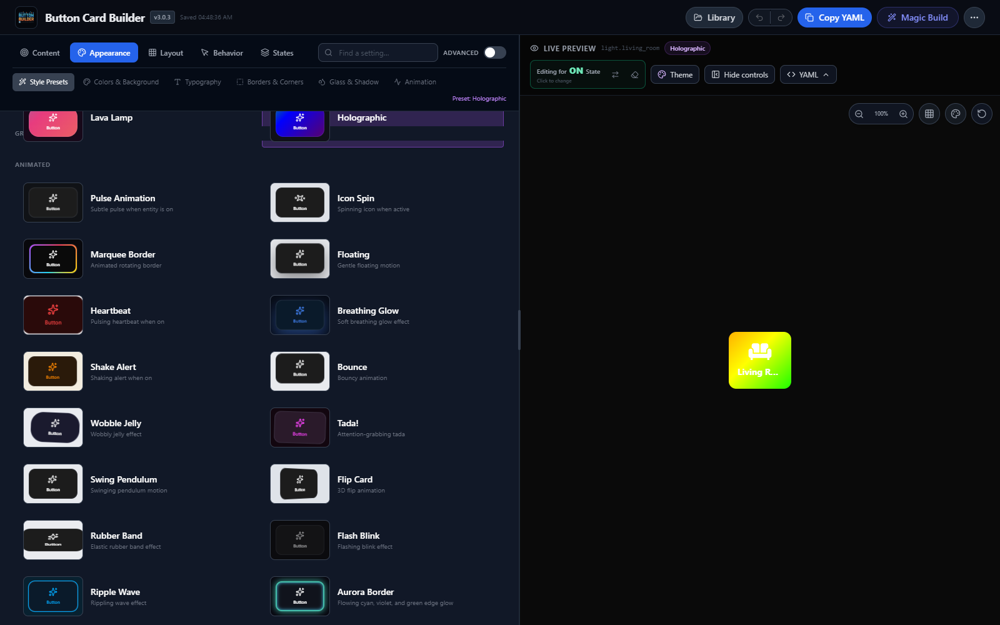

# Button Builder for Home Assistant

**Create and customize `custom:button-card` controls visually—without hand-writing YAML.**

A Home Assistant sidebar editor with live previews, state-based styling, presets, YAML import/export, and optional AI-assisted designs.

[**Install**](docs/INSTALLATION.md) · [**Quick start**](docs/QUICKSTART.md) · [**Watch the video**](https://raw.githubusercontent.com/aspenrt78/button-builder/main/final4.mp4) · [**Report a problem**](https://github.com/aspenrt78/button-builder/issues)

## See the editor

**[Watch the video](https://raw.githubusercontent.com/aspenrt78/button-builder/main/final4.mp4)**

## What you can build

- **Live visual designs:** Customize layouts, colors, gradients, fonts, icons, shadows, and animations.
- **State-aware controls:** Preview and style on/off states independently.
- **YAML import and export:** Edit an existing button-card configuration or create one from a preset.
- **Reusable styles:** Save designs, themes, and presets in a Home Assistant-backed shared library.
- **Optional AI generation:** Use Home Assistant AI Tasks or your own Gemini API key.
- **Dashboard-aware previews:** Test the appearance against backgrounds and different sizes.

Button Builder is an editor for [RomRider's `custom:button-card`](https://github.com/custom-cards/button-card), not a replacement. Install that card separately.

## Install and get started

1. Install [`custom:button-card`](https://github.com/custom-cards/button-card).
2. Install **Button Builder** through HACS. [Full installation instructions](docs/INSTALLATION.md).
3. Restart Home Assistant, then add **Button Builder** under **Settings → Devices & services**.
4. Open **Button Builder** in the sidebar and choose an entity or preset.
5. Customize the live preview and copy the generated YAML into a dashboard **Manual** card.

[**Step-by-step quick start**](docs/QUICKSTART.md) · [**Troubleshooting**](docs/INSTALLATION.md#troubleshooting)

## Useful details

**AI is optional.** Direct Gemini keys are stored in browser `sessionStorage` for the current tab session; direct requests go to Google's API. You can use a Home Assistant AI Task provider instead.

**Upgrading from v2?** Version 3 consolidates the former Button, Bubble, and Tile builder panels into the `/button-builder` panel and focuses on `custom:button-card`. Existing dashboard YAML stays in place. [Read the migration notes](docs/RELEASE_NOTES_3.0.0.md).

**Developing locally?** See [project structure](docs/PROJECT_STRUCTURE.md) and [contributing](docs/CONTRIBUTING.md). The Vite app runs with `npm install` and `npm run dev`; `npm run build` generates the Home Assistant frontend bundle.

## Community and support

Bug reports, feedback, and contributions are welcome through [GitHub Issues](https://github.com/aspenrt78/button-builder/issues) and [pull requests](https://github.com/aspenrt78/button-builder/pulls).

If Button Builder saves you time, [support development on Buy Me a Coffee](https://www.buymeacoffee.com/aspenrt78). Sponsorship is optional; the project is free and open source under the [MIT license](LICENSE).

Built with React, TypeScript, and Vite. Credit to [RomRider and the button-card contributors](https://github.com/custom-cards/button-card).
